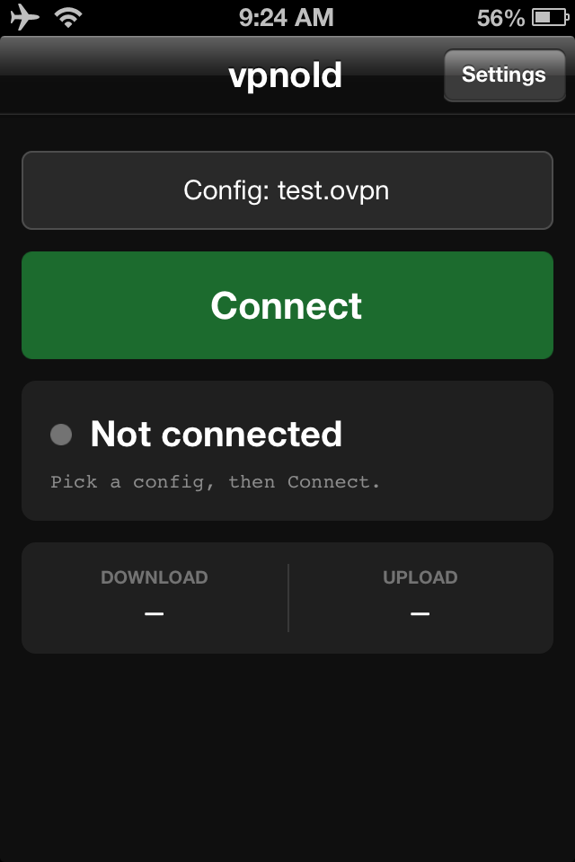
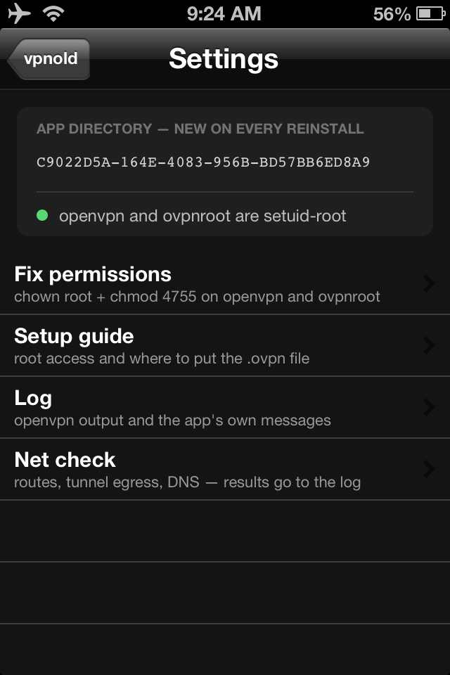
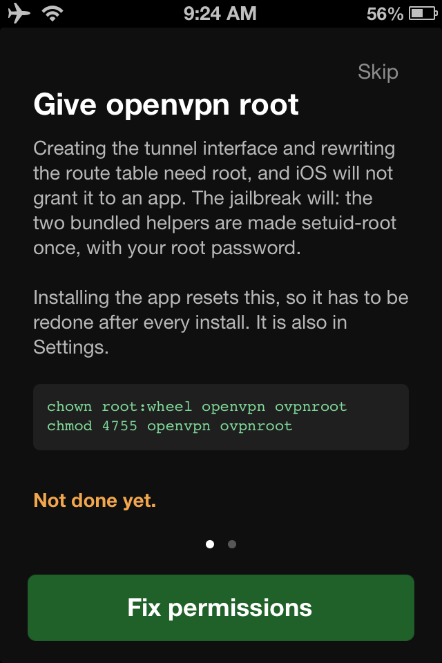
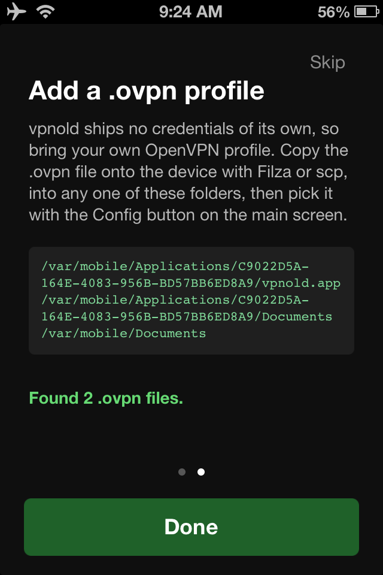

# vpnold

A real, full-device OpenVPN client for **iOS 6** on a jailbroken iPhone 4S.

## Why this is not trivial

iOS 6 has no VPN API an app can use (`NetworkExtension` is iOS 9+,
`NEVPNManager` is iOS 8+) and no way to ask for root. So vpnold does not
reimplement the protocol:

- The **real `openvpn` 2.6.x CLI**, cross-compiled armv7 against an embedded
  **OpenSSL 3.4.6** (iOS 6's Secure Transport is CBC-only; no GCM, no TLS 1.3).
- The tunnel is a kernel **utun** socket (`com.apple.net.utun_control`,
  `--dev utun --dev-type tun`), the same one iOS uses itself.
- Root comes from the jailbreak: `ovpnroot`, a tiny setuid-root shim.
- The Swift UI drives openvpn over its management socket on `127.0.0.1:7505`.

### DNS

openvpn applies no DNS on Darwin, and `/etc/resolv.conf` is not authoritative on
iOS. `ovpndns` (the bundled `--up`/`--down` helper) writes configd's dynamic
store instead, filing the pushed servers as a **supplemental resolver with an
empty match domain**, which is the only arrangement mDNSResponder does not pin to
`en0` with `IP_BOUND_IF`. Verify on-device with `scutil --dns`.

## Screens

| VPN | Settings |
|---|---|
|  |  |
| Config picker, one Connect/Disconnect button, live status + traffic. | App directory, fix permissions, setup guide, log, net check. |

| Onboarding: root | Onboarding: config |
|---|---|
|  |  |
| Shown after every install, because every install resets the helpers. | Where to drop the `.ovpn`, with a live count of what it found. |

 appears in
the navigation bar while the tunnel is up.

## Setup

vpnold ships no credentials. Put your own `.ovpn` in the app bundle,
`~/Documents`, or `/var/mobile/Documents`, then pick it on the main screen.

Profiles with a bare `auth-user-pass` (e.g. vpnbook) prompt for a username and
password on Connect, answered over the management socket. The username is
remembered per profile; the password is asked for every time and never stored.

Installing resets bundle ownership, so **after every install** the two helpers
must be made setuid-root again. The app's *Fix permissions* does this, or by
hand from a root shell:

```sh
A=$(ls -d /var/mobile/Applications/*/vpnold.app | head -1)
chown root:wheel "$A/openvpn" "$A/ovpnroot"
chmod 4755 "$A/openvpn" "$A/ovpnroot"
```

## Status

Working end to end on iPhone 4S / iOS 6.1.3: TLS 1.3, full route table, real
egress through the tunnel, DNS, clean teardown. Known gap: **IPv6 is not
tunnelled**, en0's native IPv6 is untouched.

## Attribution

OpenVPN (GPLv2), OpenSSL (Apache 2.0), icon from
[Phosphor](https://phosphoricons.com) (MIT).
